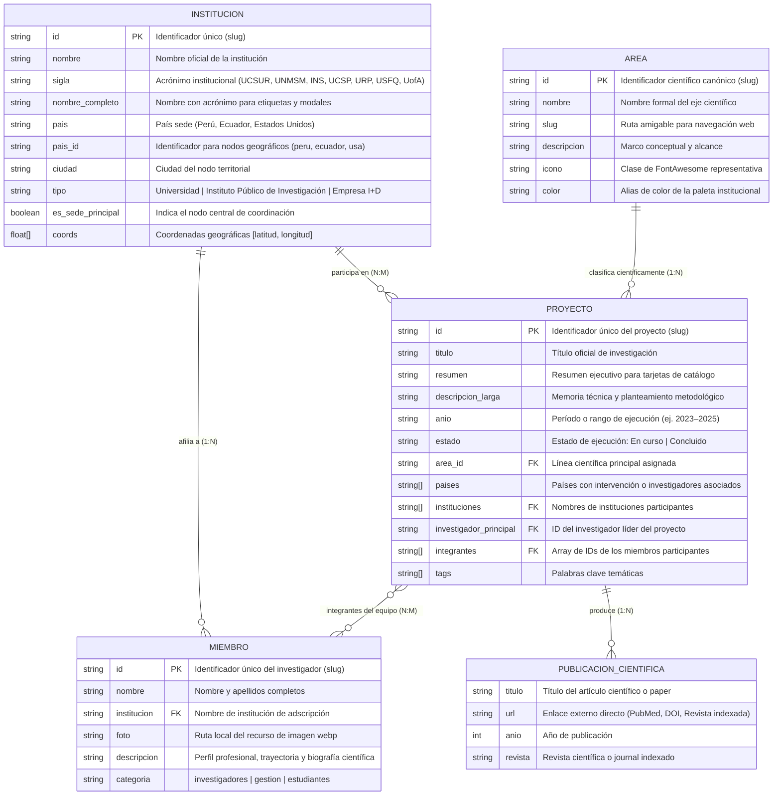

# Modelo y Diagrama de Base de Datos - Red BI4DT

Este documento describe la arquitectura relacional y el modelo de datos estructurado en formato JSON ubicado en `assets/data/` para la plataforma de la **Red BI4DT** (Red de Ciencia, Tecnología e Innovación en Informática Biomédica y Salud Global).

---

## 1. Diagrama Entidad-Relación (ERD)

---

## 2. Diccionario de Entidades y Colecciones

### A. `instituciones.json`
* **Colección:** `instituciones[]`
* **Propósito:** Mapear de forma normalizada las universidades, institutos públicos y centros de I+D de la red internacional a partir de la filiación de los miembros.
* **Campos clave:**
  * `id` (PK): Slug único (`ucsur`, `unmsm`, `ins`, `ucsp`, `procesa-lab`, `urp`, `usfq`, `arizona`).
  * `nombre`: Nombre oficial sin acrónimo.
  * `sigla`: Acrónimo oficial.
  * `nombre_completo`: Nombre formateado para visualización en el mapa (`Universidad Científica del Sur (UCSUR)`).
  * `pais_id`: Clave de agrupación territorial (`peru`, `ecuador`, `usa`).
  * `coords`: Coordenadas `[latitud, longitud]` para Leaflet / OpenStreetMap.

### B. `areas.json`
* **Colección:** `areas[]`
* **Propósito:** Definir los 6 ejes estratégicos de investigación científica de la red.
* **Campos clave:**
  * `id` (PK): Slug del área (`informatica-biomedica`, `ia-salud`, `interoperabilidad`, `analitica-datos`, `sociotecnica-adopcion`, `salud-digital`).
  * `nombre`: Denominación formal del eje.
  * `descripcion`: Fundamentación científica.

### C. `miembros.json`
* **Colecciones:** `investigadores[]`, `gestion[]`, `estudiantes[]`
* **Propósito:** Directorio del equipo humano científico y administrativo.
* **Campos clave:**
  * `id` (PK): Slug del integrante (`pamela-chacon`, `david-villarreal`, `irvin-dongo`, etc.).
  * `institucion` (FK): Nombre de la institución a la que está afiliado (relacionado con `instituciones.json`).
  * `proyectos` (FK[]): Lista de IDs de proyectos en los que participa (relación N:M).

### D. `proyectos.json`
* **Colección:** `proyectos[]`
* **Propósito:** Catálogo de iniciativas de I+D+i de la Red BI4DT.
* **Campos clave:**
  * `id` (PK): Slug del proyecto (`fhir-interoperabilidad-2023`, `hce-nacional-2022`, etc.).
  * `area_id` (FK): Clave foránea hacia `areas.json`.
  * `investigador_principal` (FK): Clave foránea al líder en `miembros.json`.
  * `integrantes` (FK[]): Claves foráneas de los co-investigadores en `miembros.json` (relación N:M).
  * `instituciones` (FK[]): Lista de instituciones vinculadas.
  * `publicaciones` (1:N anidada): Lista de artículos indexados (`titulo`, `url`, `anio`, `revista`).

---

## 3. Matriz de Relaciones y Trazabilidad en las Vistas

| Relación | Implementación Técnica | Flujo de Usuario en la Web |
| :--- | :--- | :--- |
| **Proyecto ↔ Área** | `PROYECTO.area_id` → `AREA.id` | En `proyectos.html` se filtra por línea. En `proyecto-detalle.html` el badge enlaza a `area.html?id=...`. En `area.html` se listan los proyectos de esa línea. |
| **Proyecto ↔ Miembro (N:M)** | `PROYECTO.integrantes[]` → `MIEMBRO.id` | En `proyecto-detalle.html` se muestra el equipo con fotos que enlazan a `investigacion.html?id=...`. En `investigacion.html` el perfil muestra los proyectos del miembro filtrando por `p.integrantes.includes(m.id)`. |
| **Proyecto ↔ Institución** | `PROYECTO.instituciones[]` ↔ `INSTITUCION.nombre` | En `proyecto-detalle.html` la ficha técnica muestra las instituciones socias del proyecto. |
| **Miembro ↔ Institución** | `MIEMBRO.institucion` → `INSTITUCION.nombre` | En las tarjetas de miembro y en el perfil del investigador se indica su universidad o centro de investigación. |
| **Institución ↔ Mapa de Red** | `INSTITUCION.pais_id` y `INSTITUCION.coords` | En `quienes.html` el mapa de OpenStreetMap sitúa los nodos y al hacer clic en un país el panel lateral despliega sus instituciones aliadas. |
| **Proyecto ↔ Publicación (1:N)** | `PROYECTO.publicaciones[]` | En `proyecto-detalle.html` la tarjeta "Publicaciones" lista los papers enlazados a PubMed o DOI ordenados descendentemente por año. |

